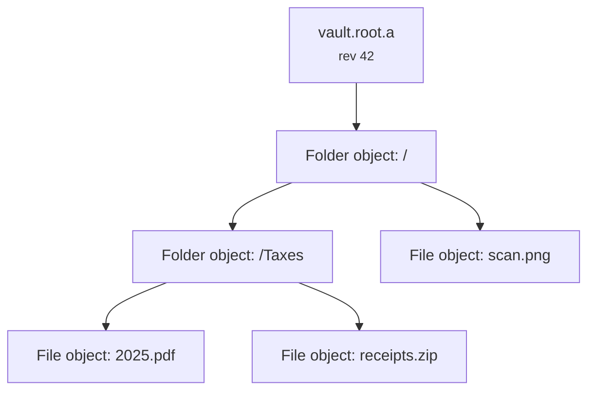
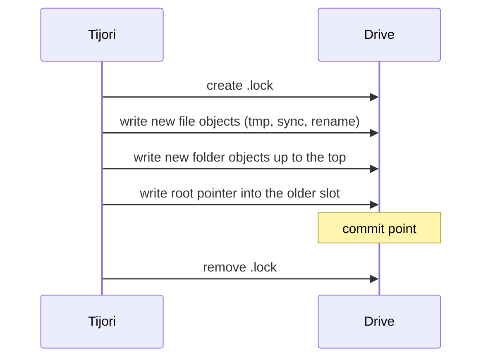

# How a vault is stored

<p class="tj-lead">A tour of the files in the <code>TIJORI</code> folder and of how a change gets written safely. The complete, normative description is the <a href="https://github.com/Mr-Sunglasses/tijori/blob/main/spec/SPEC.md">format specification</a>; when this page and the specification disagree, the specification wins.</p>

## The files on the drive

```text
/ (exFAT root)
├── README-TIJORI.txt        plain text note, optional
└── TIJORI/
    ├── vault.header         1120 bytes: keyslots and vault ID
    ├── vault.header.bak     an identical backup copy
    ├── vault.root.a         root pointer, slot A
    ├── vault.root.b         root pointer, slot B
    ├── .lock                only while a writer is active
    └── objects/
        └── 3f/
            └── 3f9a...e1.tjo   one encrypted file or folder
```

### `vault.header` and `vault.header.bak`

The header is the only part of the vault that has a fixed layout in the
clear: the magic bytes `TJRI`, the format version, the vault's random ID,
eight keyslots of 128 bytes each, and a MAC over everything. Each keyslot
holds the master key wrapped by one password, password + keyfile, or
recovery phrase, together with its salt and Argon2id settings.

The backup copy is always identical. Tijori updates the backup first and the
main copy second, so if either is damaged the other one opens the vault, and
Tijori repairs the damaged one the next time it opens the vault for writing.

### `vault.root.a` and `vault.root.b`

A root pointer is a small encrypted record: the revision number, which
folder object is the top of the vault and its hash, the vault settings
(label, padding, private-only), when it was written and by which device.

There are two, A and B, and they take turns. The pointer with the higher
revision that decrypts correctly is the current state of the vault. The
other one holds the state just before it.

### `objects/`

Every file and every folder is an **object**: a random 32-byte ID written as
64 hex characters, stored in a subfolder named after its first two
characters. Files and folders are encrypted the same way and look the same
from outside.

An object is a version byte, a 24-byte stream header, then chunks of up to
64 KiB of plaintext, each with a 17-byte authentication tag. The plaintext
starts with the content length and ends with zero padding.

A **folder object** contains a sorted list of entries. Each entry has the
name, the kind (file or folder), the child's object ID, the hash of the
child's object file, the size, the modification time and the executable bit.



## Writing a change

Objects are never modified. A change writes new objects and then moves the
root pointer:

1. **Take the lock.** Create `TIJORI/.lock` (fails if it exists) holding a
   random lock ID, the device ID and a timestamp.
2. **Write new file objects.** Each goes to `<id>.tjo.tmp`, is flushed to
   the drive, and is then renamed to `<id>.tjo`.
3. **Write new folder objects** for every folder from the change up to the
   top, because each one records the new hash of the folder below it.
4. **Write the new root pointer** (revision + 1) into the slot that holds
   the older revision. This is the **commit point**.
5. **Update this computer's rollback record**, then release the lock.

If anything stops before step 4, the old root pointer still points at a
complete old tree, and the new objects are simply unused. If the root
pointer write itself is torn, that slot fails to decrypt and the other slot
still holds the previous state. Either way the vault opens at the old state
or the new one.



## Cleaning up

Old objects stay on the drive after a change, because the other root pointer
may still need them. **Garbage collection** (`tijori gc`) walks the trees of
both root pointers and deletes every object that neither of them reaches,
plus leftover `.tmp` files and the `._` files macOS creates on exFAT.

## Locking

One writer at a time. A Tijori that finds `.lock` opens the vault read-only
and says who holds it. The writer refreshes the lock each time it commits,
so a lock that has not been refreshed for 10 minutes is likely left over
from a crash and can be removed with `tijori break-lock`.

## Rollback records

Outside the drive, each computer keeps an encrypted record per vault: the
highest revision seen, the hash of the top folder at that revision, and when
it was seen. On unlock:

| Drive compared with the record | Result |
|---|---|
| No record | First use on this computer; record it |
| Newer revision | Normal; update the record |
| Same revision, same hash | Normal |
| Same revision, different hash | Fork warning |
| Older revision | Rollback warning |

## Versions and compatibility

The header carries a major and minor format version and two sets of feature
bits. A reader refuses a newer major version or any *required* feature it
does not know, and names the version it needs; it ignores *optional*
features. New fields in folder entries and root pointers are added as new
keys, which older readers skip and keep. Tijori never upgrades a vault to a
newer format without asking.

## Limits

| Item | Limit |
|---|---|
| Keyslots | 1 to 8 |
| Argon2id memory | 64 MiB to 1 GiB (Tijori writes at most 256 MiB) |
| Name length | 1 to 255 bytes, NFC normalised, no `/` |
| Entries per folder | 200,000 |
| Folder depth | 256 |
| File size | 2^62 bytes |
