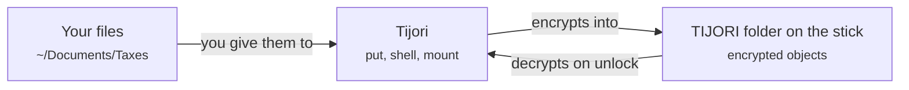

# Where your files go

<p class="tj-lead">The short answer: never into the <code>TIJORI</code> folder yourself. You hand files to Tijori, and Tijori encrypts them into that folder for you.</p>

## Two different things: the drive and the vault

When you use Tijori there are two places that are easy to mix up.

**The drive** is your USB stick as your computer sees it, for example
`/Volumes/KINGSTON`. After `tijori init` it contains a `TIJORI` folder full of
encrypted files with meaningless names. This folder is Tijori's storage room.
It is not meant to be opened, browsed or changed by hand.

**The vault** is what you see *after* unlocking: your own folders and files
with their real names, such as `/Taxes/2025.pdf`. It only exists while
Tijori has it unlocked. It is shown to you by `tijori ls`, by `tijori shell`,
or as a separate volume (for example `/Volumes/Personal`) when you
`tijori mount` it.



Think of the `TIJORI` folder as the steel box and the vault as what is
inside it. You open the box with the key (your password) through the door
(Tijori). You never reach in by drilling through the side.

## So where do I copy my files?

| Path | What it is | Copy your files here? |
|---|---|---|
| `/Volumes/KINGSTON` | The USB stick itself | Only files you do **not** need protected. Tijori ignores them. |
| `/Volumes/KINGSTON/TIJORI` | Tijori's encrypted storage | **Never.** Files you put here are not encrypted, and Tijori does not see them. |
| `/Volumes/Personal` | The vault, while mounted with `tijori mount` | **Yes.** Everything copied here is encrypted onto the stick. |
| `/` in `tijori put ... /` | The top folder inside the vault | **Yes.** This is the same place as the mounted volume. |

Pick whichever way of adding files suits you. They all end up in the same
encrypted vault:

=== "Mount it"

    ```console
    $ tijori mount
    Mounted at /Volumes/Personal. Press Ctrl+C (or eject the volume) to lock.
    ```

    The closest thing to a normal folder. Open `Personal` in Finder or your
    file manager and drag files into it.
    On Linux the volume appears under `$XDG_RUNTIME_DIR/tijori/Personal`.
    See [Mounting as a folder](mounting.md).

=== "put"

    ```console
    $ tijori put ~/Documents/Taxes ~/Pictures/scan.png /
    ```

    From the command line. The last argument is the folder **inside the
    vault**; everything before it comes from your computer.

=== "shell"

    ```console
    $ tijori shell
    tijori> put ~/Documents/Taxes /
    tijori> ls /Taxes
    tijori> exit
    ```

    Many commands with a single password prompt.

!!! danger "If you already copied files into the TIJORI folder"
    They are sitting on the stick unencrypted. Move them back to your
    computer, add them properly with `tijori put` or through the mounted
    volume, then delete the plain copies. Tijori's clean-up only removes its
    own leftovers, so it will not tidy these away for you.

## What happens when you add a file

Suppose you add `Taxes/2025.pdf`:

1. Tijori reads the file and encrypts it in 64 KiB pieces with a key that is
   unique to this one file. Each piece is sealed so that any change to it is
   detected.
2. The encrypted file is written into `TIJORI/objects/` under a random
   64-character name, like `3f9ae1....tjo`. Its real name is not used
   anywhere on the drive.
3. The `Taxes` folder's listing (names, sizes, dates, which object holds
   which file) is itself encrypted and written as a new object. So is every
   folder above it, up to the top of the vault.
4. Finally, Tijori writes a small **root pointer** that says "the vault now
   starts at this top folder". That single write is the moment the change
   counts.

Nothing is ever changed in place. A new version of a file is a new object,
and the old one is cleaned up later. That is why you can pull the drive out
at any moment: until step 4 finishes the old vault is untouched, and after
it the new one is complete. [How a vault is stored](../format/overview.md)
has the full picture.

## What someone sees on the drive

Without your password, a person holding the stick sees:

- that it holds a Tijori vault (the `TIJORI` folder and the readme say so);
- how many encrypted objects there are;
- their approximate sizes (rounded up, so exact sizes are hidden);
- when files on the stick were created, as the exFAT file system records it.

They do not see your file names, folder names, how folders are nested,
exact file sizes, dates you stored, or any content.
[What Tijori protects](../security/threat-model.md) goes into this.

## What you can safely do with the TIJORI folder

| Do | Do not |
|---|---|
| Keep it at the top of the drive, next to `README-TIJORI.txt`. | Rename it, or move it into another folder on the drive. |
| Make an encrypted copy with [`tijori backup`](backups.md). | Delete, rename or edit anything inside it. |
| Copy the whole folder somewhere while no Tijori is using it. | Add your own files to it. |
| Keep other, unrelated files elsewhere on the same stick. | Let a "drive cleaner" tool tidy it. |

## Other files on the same stick

A vault does not need the drive to itself. You can keep your ISOs, installers
or anything else next to the `TIJORI` folder, and they stay usable like
before. They are just not protected by Tijori.
