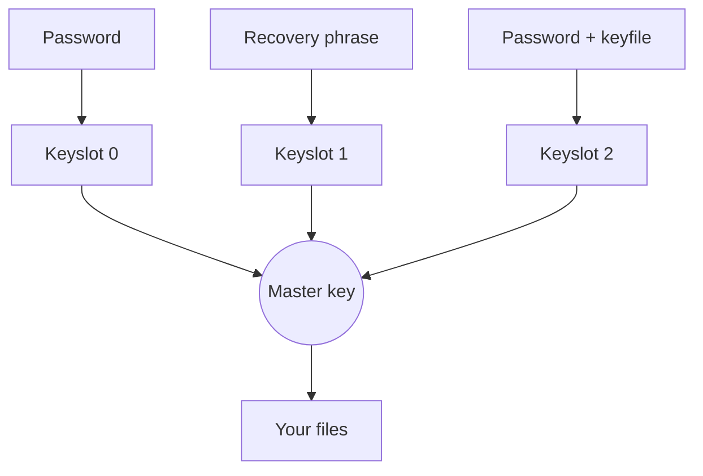

# Passwords and recovery

<p class="tj-lead">A vault can have up to eight ways in, called keyslots. Each one is a password, a password plus a keyfile, or a 24-word recovery phrase.</p>

## How keyslots work

Your files are encrypted with a random **master key** that Tijori creates
along with the vault. The master key itself is never written to the drive in
the clear. Instead, each keyslot holds a copy of it, locked with that slot's
password, keyfile or phrase.



That is why you can add and remove passwords without re-encrypting any
files: only the small locked copies change.

A new vault starts with two slots: your password (slot 0) and the recovery
phrase (slot 1).

```console
$ tijori keyslot list
Slot  Type
   0  password, Argon2id 256 MiB, t=5  (used to unlock)
   1  recovery phrase
```

## Passwords

Tijori turns your password into a key with **Argon2id**, using 256 MiB of
memory and as many passes as fit into about one second on your computer. An
attacker who steals the drive has to repeat that work for every single
guess, which makes a good passphrase practically impossible to brute force.

Tijori rejects passwords that are easy to guess (it uses the zxcvbn
estimator and asks for a score of at least 3 out of 4). Six random words is
an easy way to pass.

### Change a password

```console
$ tijori passwd
Password:
New password:
Repeat the new password:
Changed the password of keyslot 0.
Your password is changed. Someone who copied this drive before, and knows the old password, can still open that old copy. To lock them out of new changes too, re-key the vault.
```

That last message matters. Changing a password only replaces the locked copy
of the master key. A copy of the drive made earlier (including an old
backup, or old data still lingering on the flash chip) still opens with the
old password, and since the master key did not change, so would any newer
data from your drive that leaked to that person. If you change a password
because someone may know it, follow up with a [re-key](#re-key).

### Add another password

Useful for a second person, or a long "spare" password kept in a safe:

```console
$ tijori keyslot add
```

## Keyfiles

A keyfile is any file you choose, for example a photo, that must be present
together with the password. Someone who learns your password still cannot
open the vault without the file.

```console
$ tijori keyslot add --keyfile ~/keys/tijori.key   # add a password + keyfile slot
$ tijori --with-keyfile ~/keys/tijori.key ls /     # unlock with it
```

To create a vault that needs a keyfile from the start, use
`tijori init /Volumes/KINGSTON --keyfile ~/keys/tijori.key`.

A good keyfile is a few kilobytes of random data that never changes:

```console
$ head -c 4096 /dev/urandom > ~/keys/tijori.key
```

!!! warning "Keyfiles must never change"
    Tijori uses every byte of the file. If it is edited, re-saved, or
    "optimised" by a photo app, it no longer works. Keep copies, and never
    store the keyfile on the vault's drive.

## The recovery phrase

The 24 words shown when you created the vault open it on their own, without
any password. Use them if you forget your password:

```console
$ tijori --with-recovery ls /
Recovery phrase (24 words):
```

Then set a new password with `tijori --with-recovery keyslot add` and remove
the forgotten one with `tijori keyslot remove`.

To make a fresh phrase (for example if the paper was lost or seen), add a
new one, then remove the old phrase's slot. `keyslot list` shows which
number that is:

```console
$ tijori keyslot add --recovery
Added a recovery phrase in keyslot 2.
$ tijori keyslot remove 1
```

!!! danger "There is no back door"
    If you lose every password and the recovery phrase, nobody can open the
    vault: not you, not the Tijori developers, not anyone. That is the point
    of encryption, and also its main risk. Keep the phrase safe.

## Removing a keyslot

```console
$ tijori keyslot remove 2
Removed keyslot 2.
```

The slot you remove stops working at once on this drive. The last remaining
slot can never be removed.

## Re-key

`tijori rekey` replaces the master key itself and re-encrypts every file and
folder under the new one. Afterwards the vault has exactly one password and
one new recovery phrase; every other slot, the old phrase and every old
password stop working, even on old copies of the header.

```console
$ tijori rekey
Re-keying re-encrypts every file under a new master key. Afterwards the vault has exactly
one password and one new recovery phrase; other keyslots and the old recovery phrase stop working.
New password:
Repeat the new password:
Re-keyed: revision 12.
```

Use it when a password or the recovery phrase may have been exposed. It
rewrites the whole vault, so on a large vault and a slow stick it takes a
while. It is safe to interrupt: the vault opens either with the old secrets
at the old state or with the new ones.

!!! note "What re-keying cannot do"
    A copy of the drive that someone made *before* the re-key still opens
    with the old password, because it contains the old master key. Re-keying
    protects everything written from now on.
