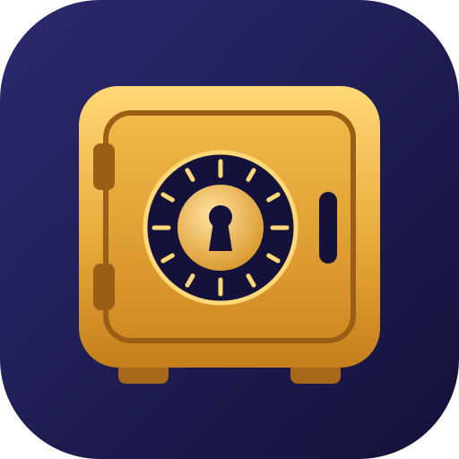

---
hide:
  - navigation
  - toc
---

<div class="tj-hero" markdown>



# Tijori

<p class="tj-tagline">Turn any USB pen drive into a strongly encrypted vault that opens on macOS, Linux and Android.</p>

[Get started](getting-started/install.md){ .md-button .md-button--primary }
[Where do my files go?](guide/how-it-works.md){ .md-button }

</div>

!!! warning "Pre-alpha"
    Tijori has not been audited and its format may still change. Try it with
    copies of your files, not the only copy.

*Tijori* (तिजोरी) is Hindi for "strongbox". Install the app, plug in the
drive, enter your password, and your files are there. Unplug it, and they are
not.

<div class="grid cards" markdown>

-   :material-lock-outline:{ .lg .middle } **Strong encryption**

    ---

    Argon2id turns your password into a key. Every file, folder and file name
    is sealed with XChaCha20-Poly1305. Only well known, libsodium-compatible
    building blocks are used.

    [:octicons-arrow-right-24: Cryptography](security/cryptography.md)

-   :material-eye-off-outline:{ .lg .middle } **Hides structure**

    ---

    Someone holding the drive sees a folder of identical-looking encrypted
    files. Names, folder layout and (by default) exact sizes are hidden.

    [:octicons-arrow-right-24: What Tijori protects](security/threat-model.md)

-   :material-usb-flash-drive-outline:{ .lg .middle } **Pull the drive anytime**

    ---

    Changes are committed copy-on-write. Unplug the drive in the middle of a
    write and the vault opens at the old state or the new one, never a broken
    mix.

    [:octicons-arrow-right-24: How a vault is stored](format/overview.md)

-   :material-key-chain-variant:{ .lg .middle } **Several ways in**

    ---

    A password, a password plus a keyfile, and a 24-word recovery phrase. Up
    to eight keyslots per vault.

    [:octicons-arrow-right-24: Passwords and recovery](guide/passwords.md)

-   :material-folder-open-outline:{ .lg .middle } **Use it like a folder**

    ---

    Mount the vault and it shows up in Finder or your file manager. Or keep
    everything inside Tijori and never put a plain copy on the computer.

    [:octicons-arrow-right-24: Mounting as a folder](guide/mounting.md)

-   :material-backup-restore:{ .lg .middle } **Backups that stay encrypted**

    ---

    `tijori backup` keeps an encrypted copy on another drive or in any
    folder, copying only what changed. Lose the stick, restore the copy.

    [:octicons-arrow-right-24: Backups and lost drives](guide/backups.md)

</div>

## Thirty seconds of Tijori

```console
$ tijori init /Volumes/KINGSTON --label Personal
$ tijori put ~/Documents/taxes /
$ tijori ls /taxes
$ tijori mount
Mounted at /Volumes/Personal. Press Ctrl+C (or eject the volume) to lock.
```

The drive stays **exFAT**, so the same vault opens on a Mac, a Linux laptop
and an Android phone. There is no account, no cloud and no telemetry: Tijori
never touches the network.

## Where things stand

| Platform | Status |
|---|---|
| macOS | Command line tool works today. Desktop app is next. |
| Linux | Command line tool works today. Desktop app is next. |
| Android | Planned for version 1. |
| Windows, iOS | Later. |

See the [roadmap](project/roadmap.md) for details.
