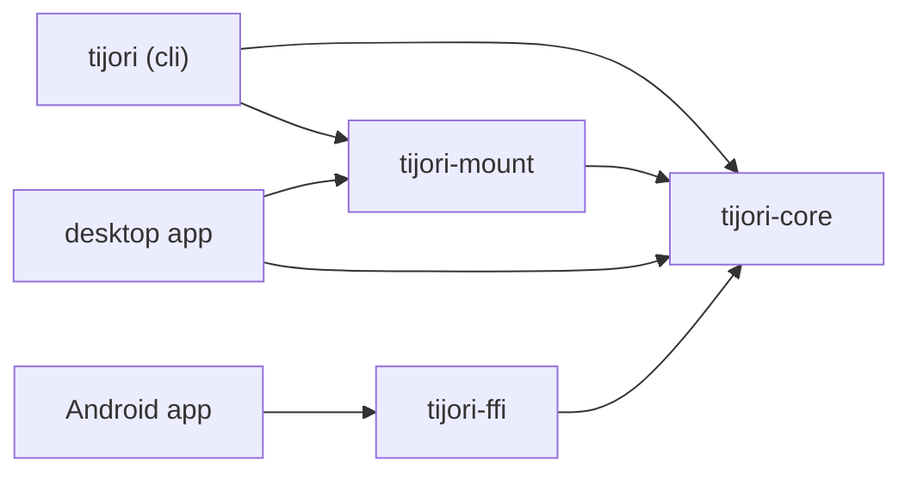

# Development

<p class="tj-lead">How the code is organised, how to run the checks, and the rules every change follows.</p>

## Repository layout

| Path | What | Licence |
|---|---|---|
| `spec/` | The vault format specification, test vectors and their Python generator | Apache-2.0 |
| `core/` | `tijori-core`: cryptography, format and the vault engine | Apache-2.0 |
| `cli/` | The `tijori` command line tool | GPL-3.0-or-later |
| `mount/` | `tijori-mount`: the FUSE file system and host hardening | GPL-3.0-or-later |
| `ffi/` | `tijori-ffi`: bindings for the Android app | Apache-2.0 |
| `desktop/` | The Tauri desktop app (Milestone 5) | GPL-3.0-or-later |
| `fuzz/` | `cargo-fuzz` targets for every parser | Apache-2.0 |
| `docs/` | This site | |



`tijori-core` does all the cryptography and never touches the disk directly:
it reads and writes through a small `Storage` trait. The command line tool,
the desktop app and the Android app each provide a `Storage` for their
platform, and an in-memory one with fault injection drives the crash tests.

## Build and test

```console
$ cargo build --workspace
$ cargo test --workspace
```

The toolchain version is pinned in `rust-toolchain.toml`. Tests that create
vaults use the fastest allowed key derivation, so the whole suite runs in
seconds.

Before sending a change, run what CI runs:

```console
$ cargo fmt --all --check
$ cargo clippy --workspace --all-targets --all-features --locked -- -D warnings
$ cargo test --workspace --all-features --locked
$ cargo deny --locked check
$ cargo audit --deny warnings
```

### Tests on real file systems

```console
$ scripts/e2e.sh target/debug/tijori          # every command on an exFAT image
$ scripts/mount-test.sh target/debug/tijori   # ordinary tools on a mounted vault
```

On macOS both use `hdiutil` disk images. On Linux `e2e.sh` needs `sudo`,
`exfatprogs` and the `exfat` kernel module; `mount-test.sh` needs FUSE 3.

### Test vectors

```console
$ python3 -m venv spec/generator/.venv
$ spec/generator/.venv/bin/pip install -r spec/generator/requirements.txt
$ spec/generator/.venv/bin/python spec/generator/gen.py --check
```

`--check` regenerates every deterministic vector with libsodium and fails if
it differs from the committed files.

### Fuzzing

```console
$ cd fuzz
$ cargo +nightly fuzz run header
```

Targets: `header`, `root_pointer`, `dir_cbor`, `object_stream`. CI runs each
for five minutes every night.

## This documentation

```console
$ python3 -m venv .venv-docs
$ .venv-docs/bin/pip install -r docs/requirements.txt
$ .venv-docs/bin/mkdocs serve
```

Then open <http://127.0.0.1:8000>. `mkdocs build --strict` is what CI runs.

## Rules for every change

1. **The specification wins.** If code and `spec/SPEC.md` disagree, the code
   is wrong. Format changes start as an issue and land together with new
   test vectors.
2. **No new cryptography.** Only the primitives and constructions in the
   specification.
3. **Tests first** in `core/`.
4. **No `unsafe` in `core/`.** It is `#![forbid(unsafe_code)]`. Elsewhere,
   `unsafe` needs a `// SAFETY:` comment.
5. **Secrets hygiene.** Keys and passwords live in zeroizing types and are
   never logged, printed or sent to another process.
6. **No network access** at run time, from any crate, app or script.
7. **Small commits** with [Conventional Commits](https://www.conventionalcommits.org)
   messages.

Security problems go to the address in `SECURITY.md`, not to public issues.
See `CONTRIBUTING.md` for the details.
