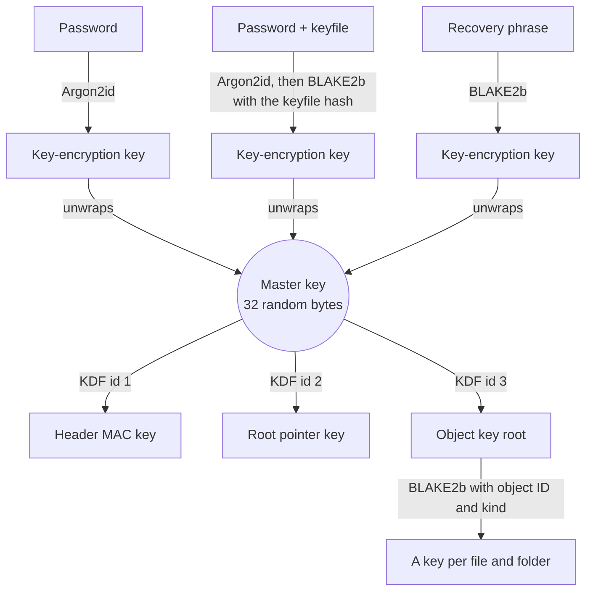

# Cryptography

Which algorithms Tijori uses, how the keys fit together, and why. Nothing here is new cryptography: every piece is a standard construction, used the way its designers intended.

## Building blocks

| Purpose | Algorithm | Notes |
|---|---|---|
| Password to key | **Argon2id** v1.3 | 256 MiB of memory on desktops (128 MiB on Android), passes tuned so one unlock takes about a second. One lane. |
| Locking keys and small records | **XChaCha20-Poly1305** | 256-bit keys, random 192-bit nonces, so nonce reuse is not a practical concern. |
| File contents | **secretstream** (XChaCha20-Poly1305) | The stream construction from libsodium, in 64 KiB chunks, with a final-chunk marker so truncation is detected. |
| Hashes and key derivation | **BLAKE2b** | 256-bit output. Subkeys come from BLAKE2b key derivation with the context `TJRIv1__`. |
| Recovery phrase | **BIP-39** English words | 24 words, 256 bits of entropy. |
| Password strength | **zxcvbn** | New passwords need a score of at least 3 of 4. |

All of these are exactly the primitives of [libsodium](https://doc.libsodium.org).
Tijori uses [dryoc](https://github.com/brndnmtthws/dryoc), a pure Rust
implementation compatible with libsodium, so the core needs no C code and
no `unsafe` Rust. Randomness comes only from the operating system.

## Key hierarchy

1. **The master key** is 32 random bytes made when the vault is created. It
   is never stored unwrapped.
2. **Each keyslot** wraps the master key with a key-encryption key (KEK)
   derived from that slot's secret. For a password the KEK comes from
   Argon2id with a fresh random salt. For password + keyfile, the Argon2id
   output is combined with a hash of the keyfile, so both are needed. For the
   recovery phrase, the phrase's 256 bits of entropy go through BLAKE2b
   (no Argon2id is needed for a random 256-bit secret).
3. **Subkeys** for the header MAC, the root pointers and the objects are
   derived from the master key, one per purpose, so a key is never used for
   two different jobs.
4. **Every object** (file or folder) gets its own key, derived from the
   object key root, the object's random 32-byte ID and its kind.

Changing a password re-wraps the master key and touches nothing else.
Re-keying makes a new master key and re-encrypts every object.

## What binds things together

Encryption alone stops reading. These bindings stop rearranging:

- **Every chunk** of an object is authenticated with the object's ID and kind
  as associated data. A chunk moved into another object, or a file object
  presented as a folder, fails.
- **Every folder** stores, for each entry, the BLAKE2b hash of the child
  object's whole file. Tijori checks the hash *before* decrypting, so a
  swapped or replaced object is caught even if it is itself valid.
- **The root pointer** names the top folder and its hash, and is encrypted
  with the vault ID and its slot letter (A or B) as associated data. Copying
  pointer A over pointer B, or from another vault, fails.
- **The header** carries a MAC over all its bytes, keyed from the master key,
  checked right after a keyslot opens.
- **Every keyslot** is wrapped with the vault ID, its slot number and its own
  parameters as associated data, so slots cannot be moved between positions
  or vaults, and their Argon2id settings cannot be weakened unnoticed.

Every string that is hashed or authenticated begins with its own label (such
as `TJRI obj v1`), so a value made for one purpose can never be mistaken for
another. All comparisons of tags and hashes run in constant time.

## Keys in memory

While a vault is unlocked, its keys sit in memory that is locked against
being swapped to disk where the operating system allows it, and they are
wiped when the vault locks. Passwords, key-encryption keys and keyfile bytes
are wiped as soon as unlocking finishes. No secret is ever logged, printed,
or sent to another process.

## How the implementation is checked

- **Test vectors.** An independent implementation in Python, built on
  libsodium through PyNaCl, generates the expected output for every format
  structure and every key derivation. The Rust code must reproduce them byte
  for byte. CI regenerates them on every change and compares.
- **Crash testing.** Every operation that writes is re-run with a simulated
  crash at each write, in three ways (write fails, write is torn in half,
  file deleted before rename). The vault must always open at the old or the
  new state.
- **Tamper testing.** Bytes of a sample vault are flipped one at a time
  (every byte of small files, and the chunk boundaries plus a dense sample of
  large ones); each flip must be reported as tampered or damaged, never
  accepted.
- **Fuzzing** of every parser, with `cargo-fuzz`.

## Further reading

- [How a vault is stored](../format/overview.md) for the layout on disk.
- The full [format specification](https://github.com/Mr-Sunglasses/tijori/blob/main/spec/SPEC.md).
